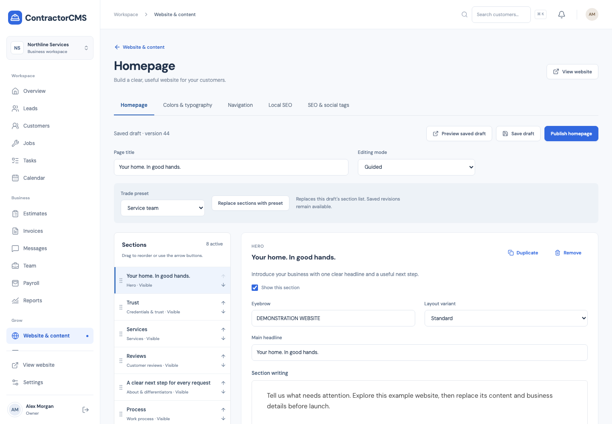

<!-- Author: ramanpal singh | URL: https://kwebby.com -->

# ContractorCMS

**A self-hosted website and business workspace for contractors.**

ContractorCMS brings your public website, leads, field work, client conversations, invoices and employee payslips into one installation. Built for roofers, plumbers, electricians, HVAC companies, remodelers and other trades in the US and Canada. One company owns each installation; branches and multiple trades can share it.

**Development release:** core workflows have been exercised locally on PostgreSQL and MySQL. Clean production-host certification, real-provider acceptance testing and an independent manual penetration test remain release gates. See [implementation status](docs/IMPLEMENTATION.md), [validation evidence](docs/VALIDATION.md) and [release acceptance](docs/RELEASE-ACCEPTANCE.md).



*The screenshot uses a fictional demonstration company.*

## What you can do

| Area | Included |
|---|---|
| Website | Guided homepage with 16 section types and four presets; editable text, images, headings, buttons, order and visibility; dedicated settings pages |
| Writing and layouts | BlockNote writing, GrapesJS layout designer, revisions, previews and explicit publication |
| Themes | Upload a restricted Twig/CSS ZIP, configure settings, preview, activate and roll back; application screens retain their own interface |
| Appearance | Brand colors, spacing, navigation and eight locally hosted Google Fonts families with their licenses |
| SEO and local presence | Page metadata, canonical URLs, redirects, sitemaps, structured-data graph, Open Graph/X tags, public business identity, real branches and manual citation consistency checks |
| CRM and operations | Lead pipeline, contacts, estimates, jobs, visits, change orders, Kanban tasks with checklist progress, calendar and dated CRM notes |
| Client portal | Verified accounts, approved customer linking, exact-revision estimate/change approval, job messages, invoices and receipts |
| Team and communications | Invitations, roles and record-level permissions, privileged MFA, chat, notifications, SMTP and editable email templates |
| Finance | Immutable issued invoices and PDF snapshots, invoice designer, credits/refunds, Stripe and PayPal adapters, offline payments |
| Workforce | Compensation records, timesheets, approved pay runs, private payslips and exports; supplied/imported taxes rather than statutory payroll calculation |
| AI lead tools | Service-visit preparation, project-scope drafting and pasted-text quote comparison; configurable provider credentials, budgets and optional verified-email reports |
| Hosting | Local file storage, durable outbox, bounded CLI cron, backup/restore and application health checks |

Payment, email and AI services require your own configuration. Local SEO observations do not automatically edit external directories, and SEO features do not guarantee rankings or AI citations.

## Requirements

- **PHP 8.4.1+** and required extensions; **Composer 2** for a source installation.
- **PostgreSQL or MySQL**, or a Supabase PostgreSQL connection. Firestore is experimental and is not a certified deployment option.
- **Node.js 22.22.2+** and npm for development/building. A packaged release includes compiled assets and production PHP dependencies, so its production server does not need Node or Composer.
- Apache or Nginx with the document root pointed at `public/`, protected writable storage, PHP CLI cron, and outgoing HTTPS/SMTP as required by your integrations.

Exact package versions, PHP extensions and compatibility limits: [dependencies](docs/DEPENDENCIES.md).

## Install

Choose the [full installation guide](docs/INSTALLATION.md) for either a prebuilt package or a source checkout. For local development from source:

```bash
git clone https://github.com/kwebby/ContractorCMS.git
cd ContractorCMS
cp .env.example .env
composer install
php artisan key:generate
```

Edit `.env` with your database connection and application URL. For **local HTTP only**, use `APP_ENV=local`, `APP_DEBUG=true`, `APP_URL=http://127.0.0.1:8000`, `SESSION_SECURE_COOKIE=false` and `CMS_MFA_REQUIRED=false`. Keep the secure defaults for a production HTTPS installation. The installation guide includes PostgreSQL, MySQL and Supabase examples.

```bash
npm ci
npm run build
php artisan migrate --force
php artisan cms:doctor --install
php artisan cms:install
php artisan serve --host=127.0.0.1 --port=8000
```

The installer creates the first owner and locks bootstrap access. It prompts for a password without echoing it. Visit `/login`, configure the business and website, invite staff, then publish your first pages. Add the [cron entry](deploy/shared-host.cron) for email/outbox processing. Development demo seeding is optional and documented separately; no default owner password is shipped.

## Documentation

| Guide | Covers |
|---|---|
| [Installation](docs/INSTALLATION.md) | Source and packaged installations, first owner, database setup and troubleshooting |
| [Dependencies](docs/DEPENDENCIES.md) | PHP/JS packages, extensions, build tools, hosting requirements and licenses |
| [Configuration](docs/CONFIGURATION.md) | Environment, business settings, SMTP, payments, AI, roles and notifications |
| [Deployment and recovery](docs/DEPLOYMENT.md) | Apache/Nginx, shared hosting, Docker, cron, backups, restoration and upgrades |
| [Theme development](docs/THEMES.md) | Package structure, Twig slots, settings, CSS/fonts/images, ZIP packaging, activation and rollback |
| [Starter theme source](docs/themes/contractorcms-starter) | A complete editable example to copy and package |
| [Development](docs/DEVELOPMENT.md) | Code structure, application boundaries, extending features, testing and release packaging |
| [Architecture](docs/ARCHITECTURE.md) | Persistence, authorization, finance, publishing and communications |
| [Implementation status](docs/IMPLEMENTATION.md) | What is implemented and what still needs delivery or certification |
| [Security review](docs/Security-review.md) | Security controls, known limitations and remaining review |
| [Validation evidence](docs/VALIDATION.md) | Observed test results and their limits |
| [Release acceptance](docs/RELEASE-ACCEPTANCE.md) | Production release gates |
| [Contractor website research](docs/research/contractor-sites-2026-10/README.md) | 24-business research and the homepage/local-SEO design rationale |

## Build a theme

Copy [the starter source](docs/themes/contractorcms-starter), edit `theme.json`, `settings.schema.json`, the Twig templates and local CSS/assets, then create a ZIP with **`theme.json` at the archive root**. Upload it in **Website → Themes**, preview it and activate it.

Themes control public body layouts. ContractorCMS owns authentication, forms, metadata, schema and script loading. Theme packages contain no PHP, JavaScript, dependency installers or server configuration. The [theme guide](docs/THEMES.md) explains the supported custom structure, exact restrictions, commands for packaging, and how to extend application code when a feature needs more than a theme.

## Development and checks

```bash
composer run dev
npm run typecheck
npm test
npm run build
php artisan test --compact
composer audit
npm audit --omit=dev --audit-level=high
```

Use a **dedicated test database**, never an installation containing business data. SQL concurrency tests rebuild their test schema. Browser tests require a separately running, seeded local application and explicit test credentials. See [development](docs/DEVELOPMENT.md) for setup and commands.

Build a deployable archive with:

```bash
bin/package-release
```

The archive in `dist/` includes built frontend assets and production Composer dependencies. It excludes `.env`, runtime credentials, private uploads, development databases and test output. GitHub's automatic source ZIP is a source checkout, not this prebuilt package.

See [release notes](CHANGELOG.md) and the [security policy](SECURITY.md).

## License and author

ContractorCMS is available under the [MIT license](LICENSE). Third-party dependencies and bundled fonts retain their original licenses; see [third-party notices](THIRD_PARTY_NOTICES.md).

**Author:** ramanpal singh — [kwebby.com](https://kwebby.com).
